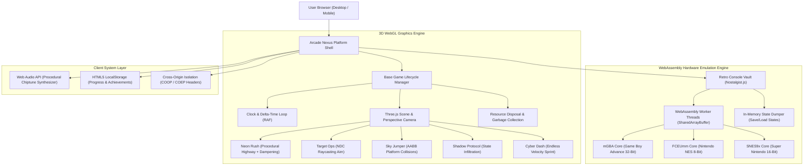

# Arcade Nexus — Next-Gen 3D & Retro Web Simulation Hub

<div align="center">

[](https://arcade-nexus-roan.vercel.app/)
[](https://threejs.org/)
[](https://webassembly.org/)
[](https://vitejs.dev/)
[](LICENSE)

<br/>

**A zero-latency, client-side gaming platform combining procedural Three.js WebGL graphics with native C-compiled Libretro console emulation.**

[Explore Live Demo](https://arcade-nexus-roan.vercel.app/) · [View Architecture](#-system-architecture) · [Game Modules](#-simulation-cabinets) · [Run Locally](#-quickstart)

</div>

---

## 🌟 Executive Overview

**Arcade Nexus** is an interactive, browser-native gaming hub engineered to showcase the capabilities of modern web standards without relying on heavyweight backend infrastructures.

- **Dual-Engine Architecture:** Runs five custom procedural 3D simulations in **Three.js** alongside a hardware-accurate **WebAssembly** console emulator (*Retro Vault*).
- **100% Client-Side Execution:** Zero backend game servers, zero streaming latency, and zero cloud hosting costs.
- **Micro-Footprint:** Total initial bundle is under **600 KB**, loading in less than **1 second** and maintaining a smooth **60+ FPS** across desktop and mobile devices.
- **Enterprise Web Security:** Configured with browser **Cross-Origin Isolation (`COOP` / `COEP`)** to unlock multi-threaded `SharedArrayBuffer` memory access for WebAssembly workers.

---

## 🏛️ System Architecture

Arcade Nexus operates as a unified single-page application orchestrating two independent graphics and computation pipelines:



---

## 🎮 Simulation Cabinets

Arcade Nexus features six distinct interactive arcade experiences:

### 1. 🏎️ Neon Rush — Highway Sprint Simulator
* **Technology:** Procedural Three.js WebGL, `THREE.MathUtils.damp()`, Dynamic FOV zooming.
* **Gameplay:** Navigate a high-speed three-lane cyberpunk highway. Dodge dynamic oncoming traffic cars in varying palettes and collect gold credits.
* **Features:**
  * Animated dashed highway lane dividers and roadside neon light pillars scrolling at road speed.
  * 3D vehicle model with rotating cylinder wheels, glowing headlights, red tail lights, and dynamic banking roll tilt when steering.
  * Shift-activated **Nitro Boost** with real-time recharging gauge and camera field-of-view expansion ($60^\circ \to 68^\circ$).

### 2. 🎯 Target Ops — Precision Cyber Drone Range
* **Technology:** Normalized Device Coordinate (NDC) Raycasting, 3D Vector Math.
* **Gameplay:** 45-second tactical shooting challenge against floating robotic drones equipped with glowing energy cores and rotating torus rings.
* **Features:**
  * Direct canvas mouse tracking with a holographic laser crosshair reticle that locks on target hover.
  * Laser weapon recoil kickback, floating damage score popups (`+100`, `+200`), and progressive combo multipliers.
  * Smooth camera micro-sway responding to mouse movements for an authentic light-gun arcade cabinet feel.

### 3. ☁️ Sky Jumper — Celestial Platformer
* **Technology:** Delta-time Euler physics, AABB surface landing detection, moving platform math.
* **Gameplay:** Traverses nine floating celestial islands with grass tops and stone bases to reach the cosmic portal.
* **Features:**
  * Full 4-way movement (`WASD` / Arrow keys) and double-jump mechanics (`Space`).
  * Horizontally sliding dynamic platforms to test timing and spatial estimation.
  * Three-lives safe checkpoint system (`lives = 3`) that safely respawns the player on the last verified island surface.

### 4. 🔐 Shadow Protocol — Facility Infiltration
* **Technology:** Finite state machine progression, proximity distance checks, QTE parser.
* **Gameplay:** Stealth infiltration: locate security keycards, interface with access terminals, and execute rapid multi-key bypass sequences (`Q`, `E`, `R`, `F`) to breach security blast doors.

### 5. ⚡ Cyber Dash — Supersonic Runner
* **Technology:** OOP Class Inheritance (extends `Neon`), progressive velocity acceleration ($v = 20 + 0.4t$).
* **Gameplay:** An endless cyberpunk sprint testing reflexes with jumping over barriers and lane-switching hazards at supersonic speeds.

### 6. 👾 Retro Vault — Hardware Console Emulation
* **Technology:** WebAssembly (Wasm), Emscripten, Libretro emulator cores, HTML5 File API.
* **Gameplay:** Full hardware-level emulation for classic 8-bit, 16-bit, and 32-bit consoles.
* **Included Titles:**
  * **Anguna: Warriors of Faith** (Game Boy Advance — Top-down action RPG)
  * **Sushi The Cat** (Game Boy Advance — Arcade physics platformer)
  * **Alwa's Awakening** (NES — 8-bit retro platformer demo)
* **Custom ROM Support:** Drag-and-drop or upload any personal `.gba`, `.nes`, `.sfc`, `.gbc`, or `.zip` ROM directly from your local filesystem.
* **Hardware Features:** In-memory instant save states (`Save State`), load states (`Load State`), hardware resets, and fullscreen mode.

---

## 🛠️ Technology Stack & Engineering Highlights

| Component | Technology | Rationale |
|---|---|---|
| **Frontend Platform** | Vanilla JavaScript (ES2022) | Eliminates framework overhead; provides direct access to high-frequency frame updates ($60\text{--}144\,\text{Hz}$). |
| **3D Rendering** | Three.js (WebGL) | Fast diffuse lighting, procedural mesh generation, low-overhead raycasting. |
| **Emulation Core** | Libretro via Nostalgist.js | Near-native C emulator execution compiled to WebAssembly without server dependencies. |
| **Build Pipeline** | Vite 7 & Rollup | Instant hot module replacement (HMR), tree-shaking, and optimized asset chunking. |
| **Sound Engine** | Web Audio API | Procedural sound synthesizer generating chiptunes and audio effects without external audio files. |
| **Security Isolation** | COOP & COEP | Enforces browser cross-origin isolation required for `SharedArrayBuffer` multi-threading. |
| **Storage & State** | HTML5 `localStorage` | Client-side JSON persistence for high scores, earned credits, and achievement unlocks. |

### Key Engineering Decisions:

1. **Client-Side WebAssembly vs. Cloud WebRTC Streaming:**
   Instead of hosting expensive Linux VPS servers with GPU encoding and WebRTC video streaming (which introduces network latency and recurring infrastructure bills), Arcade Nexus compiles Libretro cores directly to WebAssembly. Games run natively on the player's device with **zero server costs** and **zero network input lag**.

2. **Memory Leak Prevention:**
   Single-page applications with WebGL can quickly exhaust GPU memory if scenes are not disposed properly. Arcade Nexus implements a strict `destroy()` lifecycle on every game switch:
   * Cancels active `requestAnimationFrame` loops.
   * Recursively traverses meshes to invoke `geometry.dispose()` and `material.dispose()`.
   * Cleans WebGL buffers via `renderer.dispose()` and strips all active event listeners.

3. **Deterministic Delta-Time Physics:**
   All object velocities, animations, and camera damping equations are scaled by delta-time (`Math.min(0.05, clock.getDelta())`). This guarantees uniform game speeds across 60 Hz, 120 Hz, and 144 Hz displays.

---

## 🎮 Controls Reference

| Simulation | Primary Controls | Action Keys |
|---|---|---|
| **Neon Rush** | `A` / `D` or `←` / `→` (Steer) | Hold `Shift` (Nitro Boost) |
| **Target Ops** | Mouse Movement (Aim) | Left Click (Fire Laser) |
| **Sky Jumper** | `W` / `A` / `S` / `D` or Arrows (Move) | `Space` (Jump & Double-Jump) |
| **Shadow Protocol** | `W` / `A` / `S` / `D` or Arrows (Move) | `E` (Interact) · `Q`, `E`, `R`, `F` (Hack) |
| **Cyber Dash** | `←` / `→` or `A` / `D` (Switch Lanes) | `Space` (Jump Obstacles) |
| **Retro Vault** | Arrow Keys (D-Pad) | `X` (A Button) · `Z` (B Button) · `Enter` (Start) · `Shift` (Select) |
| **Universal** | `P` (Pause / Resume) | `R` (Restart Current Simulation) |

---

## ⚡ Quickstart

### Prerequisites
* **Node.js** 20.x or 22.x LTS
* **npm** or **pnpm** / **yarn**

### 1. Clone the repository
```bash
git clone https://github.com/shantaanuuu/arcade-nexus.git
cd arcade-nexus
```

### 2. Install dependencies
```bash
npm install
```

### 3. Run the development server
```bash
npm run dev
```
Open [http://localhost:5173](http://localhost:5173) in your browser.

### 4. Build for production
```bash
npm run build
npm run preview
```

---

## 🚀 Deployment

Arcade Nexus is pre-configured for 1-click deployment on modern edge static hosting platforms:

### Deploying to Vercel
1. Import the repository in [Vercel](https://vercel.com).
2. Framework preset: **Vite** (auto-detected).
3. The included `vercel.json` automatically injects the required Cross-Origin Isolation headers:
   ```json
   {
     "headers": [
       {
         "source": "/(.*)",
         "headers": [
           { "key": "Cross-Origin-Opener-Policy", "value": "same-origin" },
           { "key": "Cross-Origin-Embedder-Policy", "value": "credentialless" }
         ]
       }
     ]
   }
   ```
4. Click **Deploy**.

### Deploying to Netlify / Cloudflare Pages
* The included `public/_headers` file configures the security headers automatically:
  ```http
  /*
    Cross-Origin-Opener-Policy: same-origin
    Cross-Origin-Embedder-Policy: credentialless
  ```

---

## 📜 License

This project is open-source and available under the [MIT License](LICENSE).

---

<div align="center">
  <sub>Built with Three.js, Libretro WebAssembly, and Vite. Designed & Engineered by Shantanu.</sub>
</div>
